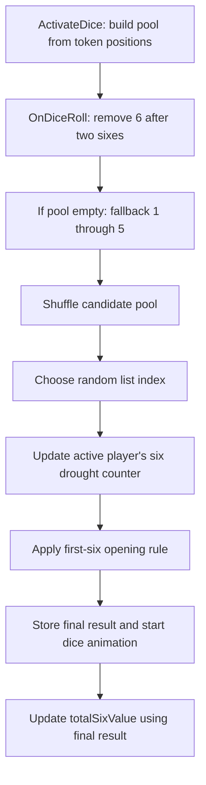

# Ludo King: local Classic dice logic

Build: `com.ludo.king` 10.6.0.416, versionCode 416. Source: the installed APKs extracted from emulator-5554 into this directory. This report focuses on local pass-and-play with human slots (`b_is234Player = true`, `_LmpBots[turn] = 0`), ordinary Classic rules, and tutorial inactive. Computer assistance and server outcomes are outside this scope.

## Main finding

The local result is a random candidate passed through stateful rules. The candidate pool depends on the active player's tokens; separate counters can force a six. Consequently, local rolls are not consistently independent uniform draws from 1–6.

The normal order reconstructed from native instructions is:



This is static verification of executable ARM64 code, not a live trace of internal fields. Mode flags and optional serialized settings have not been read from a running Unity object.

## 1. The board changes the candidate numbers

`GameController.ActivateDice`, RVA `0x20CE6B0`, constructs the pool before the next roll. It examines ordered pairs of the active player's four tokens, excluding a token paired with itself. For ordinary Classic, a value `d` from 1 through 6 is collected for removal when:

- Both tokens are out of their starting base (`b_isOffTheMark`).
- The destination token is neither on a checkpoint nor already home.
- The moving token's prospective position is less than `HomeValue - 6`.
- `movingToken.pingCurrentValue + d == destinationToken.pingCurrentValue`.

Collected values are unique. The method creates `[1,2,3,4,5,6]`, then removes every collected value. This removes the number from the entire roll pool, even if another token could move by that number without landing on its own token. If removing values empties the pool, this method restores `[1,2,3,4,5,6]`.

Example: with eligible own tokens at internal positions 10 and 13, value 3 is removed because `10 + 3 == 13`. Assuming no other exclusions, the candidate pool is `[1,2,4,5,6]`. The preliminary probability of each remaining number is nominally 1/5, before the later six overrides.

This is not a general removal of every unusable move: the inspected loop specifically detects these own-token destination collisions. Quick mode has additional coordinate handling, so the Classic formula above must not be copied unchanged to Quick.

Evidence in [GameController__ActivateDice.asm](native-evidence/GameController__ActivateDice.asm): pair loop `0x20CF650–0x20CF840`; full-pool storage at `0x20CFB04`; removal loop `0x20CFBE0–0x20CFC54`; full-pool fallback `0x20CFC58–0x20CFEF8`. Field declarations are in `tools/Il2CppDumper/dump.cs`.

## 2. Two sixes restrict the next candidate

At the beginning of `DiceController.OnDiceRoll`, the code checks `GameController.totalSixValue == 2` and removes 6 if present. At the end of the method it increments this counter for a final six and resets it to zero for a final non-six. There are also resets in the turn-transition code.

Thus, in an ordinary established local game, after two consecutive sixes the next candidate is selected from the remaining values. The drought override also requires 6 to remain in the pool, so it cannot reintroduce 6 in this condition. The opening rule is a later independent override; by the time two sixes have occurred, its first-six flag would ordinarily already be set.

Correction to the earlier report: this field is **`totalSixValue` at offset `0x570`**, not `TurnCounter`. `DiceController.consicutiveSix` is another field and is not the field read by this removal check.

Evidence: [DiceController__OnDiceRoll.asm](native-evidence/DiceController__OnDiceRoll.asm), `0x209D3CC–0x209D43C` and `0x209E550–0x209E5E4`.

## 3. The two empty-pool fallbacks differ

The fallback inside `ActivateDice` restores all six values. The fallback inside `OnDiceRoll` creates **only `[1,2,3,4,5]`**. These are separate paths, at different stages of the roll. It would be incorrect to describe all empty-list recovery as a fair 1–6 roll.

Evidence: [DiceController__OnDiceRoll.asm](native-evidence/DiceController__OnDiceRoll.asm), `0x209D5B8–0x209D800`; final addition is 5 at `0x209D7D4`.

## 4. Random selection and shuffling

For local mode, `Shuffle`, RVA `0x209E6A4`, copies the candidate pool, clears the original, and randomly moves entries back using integer `UnityEngine.Random.Range`. The chosen number then comes from:

```text
index = floor(UnityEngine.Random.Range(0.0f, 1.0f) * pool.Count)
value = pool[index]
```

The shuffle changes order, not the number of copies of each ordinary candidate. It is not a persistent bag in which a rolled number is consumed until all six numbers have appeared. The pool is rebuilt by the game controller as play proceeds.

For a pool with N distinct candidates, each candidate has nominal preliminary probability 1/N under uniform index selection. This is not a measured final gameplay distribution: the subsequent rules overwrite some results. The float RNG's exact endpoint behavior and engine PRNG state were not recovered here.

Evidence: [DiceController__Shuffle.asm](native-evidence/DiceController__Shuffle.asm); selection `0x209D8C0–0x209D928` in `OnDiceRoll`.

## 5. Each local player has a six drought counter

The fields `curRollCount234` (`0x98`) and `counterToGetSix234` (`0xA0`) are integer arrays of length 7, indexed by `GameController.TurnNumber`. Slots 1 through 6 receive independent thresholds of **8, 9, or 10** during `Awake`; counters start at zero. The separate scalar threshold initially drawn from 6–8 is not the local array threshold.

After the preliminary number has been selected:

1. If the preliminary number is 6, the active player's counter resets to zero and its threshold is redrawn from 8–10.
2. Otherwise the active player's counter increments first.
3. If the new counter is at least its threshold **and the pool contains 6**, the result becomes 6, the counter resets to zero, and its threshold is redrawn from 8–10.
4. If 6 is absent, there is no forced six and the counter can continue beyond its threshold.

For example, with threshold 8 and counter 7, a preliminary roll of 2 becomes a displayed 6 if 6 is available. The trigger is the eighth non-six candidate evaluation since the reset, not a further roll after eight completed misses. These are the active player's own roll calls, including extra rolls, rather than everyone else's turns.

Evidence: [DiceController__Awake.asm](native-evidence/DiceController__Awake.asm), `0x209C370–0x209C458`; [DiceController__OnDiceRoll.asm](native-evidence/DiceController__OnDiceRoll.asm), `0x209DA34–0x209DABC` and `0x209DB14–0x209DBE0`.

## 6. The first-six opening phase

`Awake` draws each opening limit from **3, 4, 5, or 6**. Each opening branch has a counter and a Boolean that records whether that branch has already seen a six:

```text
if value == 6:
    seenSix = true
else if not seenSix:
    if openingCounter == openingLimit:
        value = 6
        seenSix = true
    else:
        openingCounter += 1
```

The comparison occurs before incrementing. Starting from counter zero and flag false, limit 3 permits three non-sixes, then forces the next result to 6. Limits 3–6 therefore correspond to a latest first six on **that player's fourth through seventh eligible roll**, unless a natural or drought-forced six occurs earlier. This is conditional on the branch being reached and the initial state being fresh.

The field mapping matters because one local player's fields retain computer-related names:

| Branch | Seen-six flag | Opening counter | Limit |
|---|---|---|---|
| My-turn branch | `b_myBlank` | `myBlank` | `maxLimit_1` |
| Turn 2 | `b_p2Blank` | `p2Blank` | `maxLimit_2` |
| Turn 3 | `b_compBlank` | `compBlank` | `maxLimit_3` |
| Turn 4 | `b_p4Blank` | `p4Blank` | `maxLimit_4` |
| Turn 5 | `b_p5Blank` | `p5Blank` | `maxLimit_5` |
| Turn 6 | `b_p6Blank` | `p6Blank` | `maxLimit_6` |

In the local path, the my-turn branch checks `TurnNumber == MySocketManager.myTurnNo` (field `0x88`). Its actual runtime value was not established; do not assume this is unconditionally turn 1. Turns 2–6 have explicit turn checks. In ordinary two-player layout, internal turn IDs can be 1 and 3 rather than 1 and 2, so the second displayed player can use the `compBlank` fields even while both participants are human.

This opening rule does not check whether 6 remains in the candidate pool. It also does not test whether all tokens have returned to base; these branches track the first-six phase, not a general new assistance phase every time a token is captured.

Evidence: opening limits `0x209C2DC–0x209C350`; my-turn gate `0x209DDD4–0x209DE20`; opening compare/override `0x209DE78–0x209DF28` and corresponding following player branches in `OnDiceRoll`.

## 7. The order creates a hidden-counter effect

The drought logic runs before the opening logic. An opening-forced six does **not** jump back to reset the drought counter. Therefore, seeing a displayed six is not enough to infer that the player's drought counter became zero.

Worked example, using supplied candidate values rather than claiming an observed emulator trace: fresh state, opening limit 3, drought threshold 8, pool containing 6, and preliminary values 2, 4, 1, 5:

| Player roll | Preliminary value | Drought counter after evaluation | Final displayed value | Opening state |
|---|---:|---:|---:|---|
| 1 | 2 | 1 | 2 | counter 1 |
| 2 | 4 | 2 | 4 | counter 2 |
| 3 | 1 | 3 | 1 | counter 3 |
| 4 | 5 | **4** | **6** | seenSix = true |

The fourth roll displays a six while leaving the drought counter at 4. Assuming no intervening preliminary six and that 6 stays available, four more non-six candidate evaluations can reach the threshold and produce a drought-forced six. A natural preliminary six would reset the drought counter normally.

## 8. Compact reconstructed local algorithm

This is explanatory pseudocode, not original recovered C# and not an exact Unity RNG clone. It assumes ordinary Classic, all-human slots, tutorial inactive, and the optional `isDiceCheatOn` flag false.

```text
# During turn activation:
blocked = own_token_collision_values(activePlayer.tokens)
pool = [1,2,3,4,5,6] minus blocked
if pool is empty: pool = [1,2,3,4,5,6]

# During roll:
if totalSixValue == 2: remove 6 from pool
if pool is empty: pool = [1,2,3,4,5]
shuffle(pool)
value = pool[floor(randomFloat(0,1) * len(pool))]

if value == 6:
    misses[turn] = 0
    threshold[turn] = randomInt(8,11)  # 8..10
else:
    misses[turn] += 1
    if misses[turn] >= threshold[turn] and 6 in pool:
        value = 6
        misses[turn] = 0
        threshold[turn] = randomInt(8,11)

apply_opening_branch_if_eligible(value, turn, myTurnNo)
# Opening can change value without resetting misses[turn].

store(value)
start_animation_for(value)
totalSixValue = totalSixValue + 1 if value == 6 else 0
```

## 9. Optional paths and limits of this result

- `Shuffle` has another periodic six-removal rule gated by computer mode or `_LmpBots[turn] == 1`. That rule is not active for the all-human local slots analyzed here.
- `Shuffle` also has an `isDiceCheatOn` branch that clears the pool to a single 5 after two sixes, otherwise a single 6 (`0x209EAC8–0x209EBC4`). Its runtime flag state and serialized default were not established, so its presence is not evidence that ordinary local play uses it.
- Arrays and explicit opening branches cover turn slots 1–6. Dedicated 5P/6P scene flags also exist. Their exact runtime configuration has not been traced for every scene; the shared rules above apply when the stated local mode gates are active.
- Classic Team Up, Quick, one-token-out startup, save/resume, and tutorial can introduce additional state or paths. This report does not claim those variants have identical startup behavior.
- The final number is computed and stored before the animation coroutine starts. Animation frames do not generate a new result on every frame. `GetDiceValue` reads the stored `ObscuredInt`; that wrapper is not a random generator.
- No fixed sequence, reliable tap-timing formula, seed, or next-number predictor was established. Counter-dependent forced results can be reasoned about only with the correct hidden state and candidate pool.

## Evidence and reproducibility

The underlying files are `extracted/split_config.arm64_v8a/lib/arm64-v8a/libil2cpp.so` and `extracted/base/assets/bin/Data/Managed/Metadata/global-metadata.dat`. `acquisition.json` records APK sizes and SHA-256 hashes. Native methods were mapped through ELF load segments and annotated with IL2CPP declarations and relocation-resolved labels using `analyze_native.py`.

Relevant evidence: `GameController__ActivateDice.asm`, `DiceController__Awake.asm`, `DiceController__OnDiceRoll.asm`, and `DiceController__Shuffle.asm` in `native-evidence/`. Branch conditions, field offsets, integer constants, and instruction order were checked against these bodies. Empty bodies in `dump.cs` are declaration stubs, not recovered source. No APK modifications were needed for this analysis.
