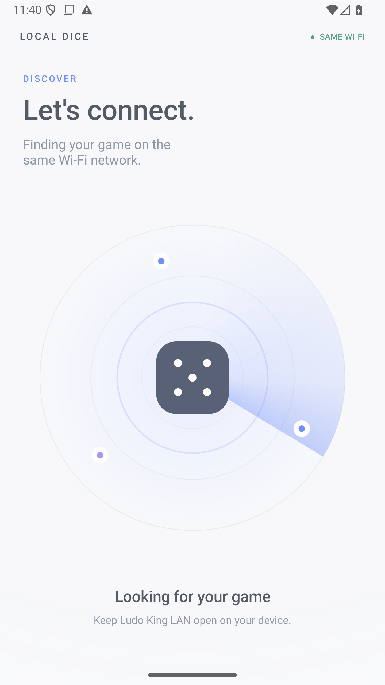
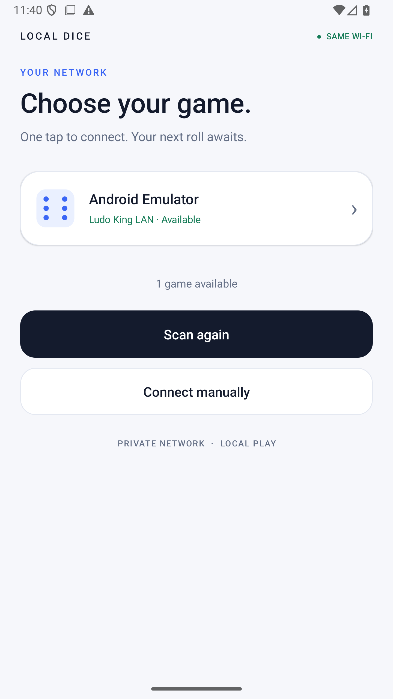
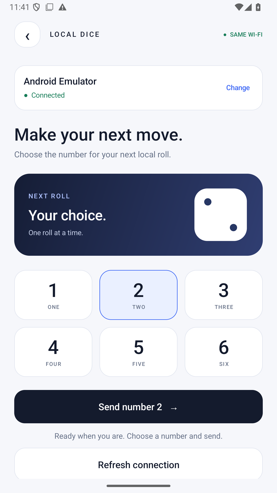

# Local Dice LAN

Android companion and local-play bridge with Wi-Fi discovery and a redesigned three-screen interface.

- Animated scanner on launch.
- One entry per game installation, including emulator/host-relay deduplication.
- Device selection opens a dedicated control screen with connection state, dice preview and numbers 1–6.
- Select a number, then send it for the next human pass-and-play roll.
- Authenticated commands, one pending number at a time, and automatic status refresh.

## Downloads and installation

Download **Local-Dice-Remote.apk** and **Ludo-King-LAN-v3.0.zip** from this repository's Releases page. The ZIP contains all four game splits, the companion, matching controller configuration, relay, installation scripts and verification records. Extract it before running `Install-Emulator.ps1` with ADB on PATH. On a physical phone, install the four game splits together with a compatible split-APK installer.

Both devices must share Wi-Fi, or the companion phone can join the game phone's hotspot. Keep the game open. Internet is not needed. For a hosted emulator, run `Start-LanRelay.ps1` on the computer. Client isolation or firewall rules may prevent discovery or connection.

Detailed instructions are in [the release guide](lan-release/README.md).

## Interface

| Scanner | Devices | Dice control |
| --- | --- | --- |
|  |  |  |

## Source and local builds

`lan-control/` contains the Java companion and game bridge, native assembly patches, build scripts, relay and verification utilities. `lan-release/` contains documentation and build/verification manifests. Original APK inputs and signing keys are kept outside Git.

The build scripts target Windows and expect Android SDK platform 35, build-tools 36.0.0, NDK 30.0.14904198, Java tooling, Python, capstone, pyelftools, and Apktool. Update the machine-specific Apktool path in `lan-control/build.py` for another workstation.

To rebuild, provide the original four version 10.6.0.416 APKs under `pulled/` and the original extracted `extracted/split_config.arm64_v8a/lib/arm64-v8a/libil2cpp.so`. Run `python lan-control/build.py`, then `python lan-control/build_remote.py`. The game build creates a new control token and development signing key when missing. Retain your existing local key if you need to install updates over a previous build. Use the matching companion and controller configuration from the same build.

## Verification and scope

Emulator checks passed for discovery deduplication, device-to-control navigation, authenticated connection, number selection, queuing, pending-button state and back navigation. Physical-phone and hotspot combinations have not been tested. During two-app instrumentation on a single emulator, the verification utility temporarily disables cached-app freezing and restores its prior setting afterward.

The override is limited to human local pass-and-play. Online/computer turns are excluded. The game copy uses the separate package `com.ludo.king.lan`; online guest login is disabled. Original game assets are included only in downloadable release packages.
